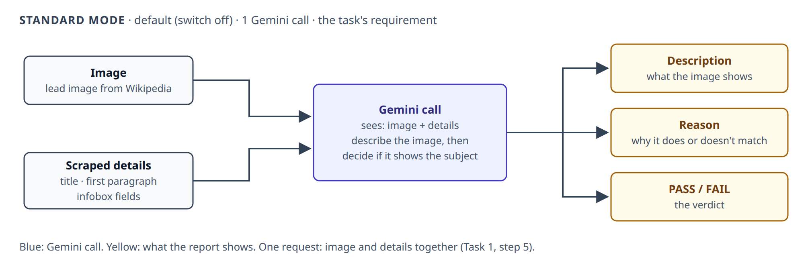
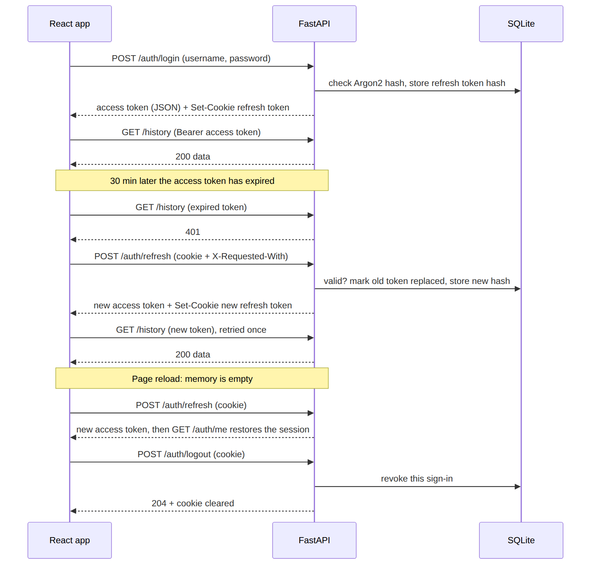

# VerifyLens - Wikipedia Image Verifier

VerifyLens takes a Wikipedia topic, finds the article and its main image, and
asks Google Gemini whether the image actually fits the article. It then
produces a Markdown verification report. Every search is saved in SQLite and
tied to the user who ran it. Users sign in. Admins manage accounts.

---

## 1. Project Overview

**Objective.** Add login and role-based access to the FastAPI backend, a
React frontend, and SQLite storage for users, searches and reports.

![Use case diagram. Actors: User and Admin; Admin inherits every User use case. User: sign in, sign out, change own password, check system status, verify a Wikipedia topic, view and download the report, view search history, delete a search record, reset a forgotten password. Verify a topic includes scraping the article and image (Wikipedia) and verifying the image with Gemini; Super mode check extends it. Reset password includes sending the reset email (mail server, optional, off by default). Admin only: manage user accounts, set a temporary password, view all users' searches, view the admin overview.](docs/images/usecase.png)

Password reset spec: [docs/specs/password-recovery.md](docs/specs/password-recovery.md).

The technology used in each layer is shown in the [architecture diagram](#3-system-architecture).

```text
backend/             Python backend (run backend commands from this folder)
  app/
    api/             HTTP layer: routes, auth dependencies, rate limits, cookies
    services/        Workflows and business rules: auth, users, search, history,
                     admin overview, password reset, refresh tokens, and the
                     pipeline with wikipedia, gemini, label check and report
    infra/db/        Database: engine, models, additive migrations, repositories
    dto/             Request/response models and validation
    config/          Settings (settings.py) and JWT settings (jwt.py)
    frontend.py      Serves the built React app
    main.py          App setup and router registration
  security/          Password hashing, password policy, JWT tokens, secret loading
  scripts/           bootstrap_admin, reset_password, backup_db, model_compare,
                     eval_metrics, perf_test, dev_mail_catcher (local fake mail server)
  tests/             Automated tests (temporary databases, no external calls)
frontend/            React + TypeScript app (src/api/client.ts is the only backend boundary)
data/                Live SQLite database (not in git)
docs/                Specifications and diagrams
.env                 Local settings and secrets (not in git), read by the backend
Dockerfile, docker-compose.yml, DEPLOY.md   Deployment
```

Backend file paths in this README are relative to `backend/`.

---

## 2. Functional & Non-Functional Requirements

### Functional requirements

**Core requirements**

| ID | Requirement | Implementation | Status |
|---|---|---|---|
| FR-01 | Authentication and authorization in the FastAPI backend | `/auth/login` issues a JWT and a refresh cookie. Every route except `/health` and the `/auth/login`, `/auth/refresh`, `/auth/logout` endpoints requires the JWT (`app/api/auth_dependencies.py`). |  Implemented and tested |
| FR-02 | Two user types: Admin and User | `user.role`, restricted to `admin` or `user` by a database CHECK constraint |  Implemented and tested |
| FR-03 | Admin can create and manage users | `/users`: create, list/search, edit name, role and active flag, reset password, delete (`app/api/user_routes.py`) |  Implemented and tested |
| FR-04 | Normal users access only authorized functionality | `require_admin` guards `/users/*` and `/admin/*`. Users see only their own history; another user's record returns 404. |  Implemented and tested |
| FR-05 | Search Wikipedia topics and receive image verification reports | `POST /search` runs scrape → download → Gemini → Markdown report (`app/services/pipeline_service.py`) |  Implemented. Tested with fakes and offline stubs. **Real end-to-end run not yet recorded.** |
| FR-06 | React frontend | `frontend/`: sign-in, verify, history, admin overview, user management |  Implemented. Production build passes. **No recorded browser run against the live backend.** |
| FR-07 | SQLite persistence and search history | `searchrecord` and `user` tables. History is paged and filterable (`app/api/history_routes.py`). |  Implemented and tested |

**Additional requirements**

| ID | Requirement | Status |
|---|---|---|
| FR-08 | Admin-created and admin-reset passwords are temporary. The user must change the password before doing anything else, and the server enforces this. |  Tested |
| FR-09 | Users change their own password. Doing so signs out all their other sessions. |  Tested |
| FR-10 | Owner or admin can delete a history record. Deleting a user keeps their searches, unlinked, for admin review. |  Tested |
| FR-11 | Admin overview: users, searches by outcome, 30-day activity, top users, recent errors |  Tested |
| FR-12 | System status check of API, database, Gemini and Wikipedia (external checks cached for 60 s) |  Tested (external checks mocked) |
| FR-13 | Failed searches are saved as `ERROR` with a reference ID. Temporary Gemini outages return 503 "try again". |  Tested |
| FR-14 | Self-service password reset by a one-time email link (15 min). Admins set each user's email. Off by default. Spec: `docs/specs/password-recovery.md`. |  Tested (fake mail sender). Verified once with real email (Gmail SMTP, dev machine, 2026-11-23). **Not yet tried on the server with the production mail account.** |
| FR-15 | Users stay signed in across page reloads and past the 30-min access token, via a rotating refresh token in an HttpOnly cookie. Logout ends the sign-in on the server. Spec: `docs/specs/auth.md` AUTH-12..18. |  Tested. **No browser run yet.** |

### Non-functional requirements

| ID | Category | Requirement | Status |
|---|---|---|---|
| NFR-01 | Security | Passwords stored only as Argon2 hashes. At least 12 characters, and must not contain the username. |  Tested |
| NFR-02 | Security | JWT expires (default 30 min) and is checked for issuer and audience. A password change revokes old tokens. Refresh tokens: HttpOnly, `Secure`, `SameSite=Strict` cookie; only the SHA-256 is stored; rotated on every use; reuse of an old token signs the user out everywhere; sign-in ends after 8 h idle or 7 days. |  Tested |
| NFR-03 | Security | The app refuses to start without a `JWT_SECRET_KEY` of at least 32 characters. Secrets never go in code or the image. |  Tested |
| NFR-04 | Security | Rate limits: login per IP (10/min) and per username (5/min), token refresh per IP (30/min), searches per user (5/min), password changes. All configurable. |  Tested |
| NFR-05 | Security | Authorization enforced on the server. React hides admin screens for convenience only. |  Tested |
| NFR-06 | Reliability | Each Gemini request is cut off after 75 s. Temporary errors (408/429/5xx) are retried with backoff. The total wait is capped at 2× the timeout. |  Tested (mocked) |
| NFR-07 | Reliability | Gemini output is validated against a JSON schema. Truncated, repetitive or over-long answers are rejected. |  Tested (mocked) |
| NFR-08 | Data safety | Schema changes at startup only add tables and columns. Online backup script provided. |  Tested |
| NFR-09 | Performance | Lists use keyset pagination capped at 50 rows. Admin overview uses aggregate queries. |  Paging tested. Measured up to 10,000 users and 100,000 searches; see [Performance](#7-testing--verification). |
| NFR-10 | Testability | Tests use temporary databases and fake or stubbed Wikipedia and Gemini. They never touch `data/`. |  Verified |

---

## 3. System Architecture

![System architecture: Browser (React 19, Vite 7) calls a reverse proxy over HTTPS, which forwards to one Uvicorn process (Python 3.12, Docker). API layer: static frontend, REST routes, security (PyJWT, Argon2), in-memory rate limiter. Service layer: search pipeline (scrape, verify, label check in Super mode, report), Playwright scraper, Gemini verifier (1 call, 2 in Super mode), label check, report, health check, refresh tokens, password reset, mail. Data layer: SQLModel/SQLAlchemy over SQLite, which CLI scripts also use. Services call Wikipedia and Gemini over HTTPS and an SMTP server over STARTTLS](docs/images/architecture.png)

Arrows point from caller to callee; each reply returns on the same connection.

In development, Vite serves React on `:5173` and forwards `/api` to FastAPI on
`:8000`. In single-server mode, FastAPI serves the built app (`frontend/dist`)
on the same origin, so CORS is not needed.

**Backend layers.** Requests flow API → service → repository → SQLite.

| Layer | Folder | Responsibility | Never |
|---|---|---|---|
| API | `app/api/` | Routes and request parsing; auth dependencies (`get_authenticated_user` → `get_current_user` → `require_admin`); rate limits; cookies and the CSRF header; turning service errors into HTTP status codes | Builds SQL or runs workflows |
| Service | `app/services/` | Workflows and business rules: login and sessions, password change and reset, user administration, the search lifecycle, history access rules, admin overview figures. Decides when to commit. | Imports FastAPI |
| Repository / infrastructure | `app/infra/db/` | Engine and sessions, table models, additive migrations, queries (`SearchRepository`, `UserRepository`, `AdminRepository`) | Holds business rules |
| Configuration | `app/config/` | `Settings` and `JWTSettings`, read from the environment, `<repo>/.env` and secret files | |
| Security | `security/` | Argon2 hashing, password policy, JWT encoding and checking, startup secret check | |

Deliberate exceptions, to keep things simple:
- Listing and counting users are plain reads, so those two routes call `UserRepository` directly; a service would only pass the call through.
- Refresh-token and reset-token queries stay inside `refresh_token_service.py` and `password_reset_service.py`. They are small, security-critical (atomic claims, reuse detection) and fully tested.
- `SearchRepository.create`, `mark_success` and `mark_error` commit on their own: the `PENDING` record must be saved before the slow pipeline runs.

**Search workflow (`POST /api/v1/search`)**

1. The JWT is validated and the user loaded. The search rate limit is checked.
2. A `PENDING` search record is saved, owned by that user.
3. Playwright opens Wikipedia, searches the topic, and extracts the title, first paragraph, infobox fields and main image URL. Then it downloads the image to a temporary folder.
4. Gemini receives the article text and the image. It returns `{description, reason, matches}`, which is validated against a schema.
5. The Markdown report is generated. The record is updated to `SUCCESS` with the report, infobox fields (JSON) and verdict.
6. The response returns the report. React renders it and offers a `.md` download.
   On failure, the record is marked `ERROR` with a short error code. The client gets 503 (temporary, such as Gemini busy), 422 (nothing to verify for this topic) or 500, with a plain-language message. The record ID stays in the logs and History.

**Verification modes and label check** (spec SRCH-14, SRCH-15)

<!-- ![Verification modes: the scraped article, lead image and image labels feed three lanes. Standard mode, the default: one Gemini call sees image and article and returns description, reason and PASS/FAIL. Super mode (API value thorough): call 1 sees only the image and writes a blind description; call 2 sees image, article and that description and returns the verdict. Label check, plain code in Super mode only: do the caption, alt text or file name contain a title word. The result keeps Gemini's verdict; in Super mode it flags Needs review when the two disagree. Standard keeps the original report.](docs/images/verification.png)

-->

Pipeline per mode:




| | Standard (default) | Super mode (API: `thorough`) |
|---|---|---|
| Gemini calls | 1 | 2 (about twice the time and cost) |
| Image description | Written in the same call as the verdict, with the article in view | Written from the **image alone**, before Gemini sees the article |
| Verdict | Image + article | Image + article + the blind description |
| Label check and "Needs review" |  |  |
| Report | The original five sections, unchanged | Adds the mode, the description's source, a labels section and any review flag |

- **Choosing a mode:** the **Super mode** switch on the Verify page (off = Standard), with an info panel explaining both modes. The API takes `"mode": "standard" | "thorough"` in `POST /search` (unknown mode → 422, nothing saved).
- **Standard mode is unchanged:** same single call, same report and behaviour as before these features. Every new feature is in Super mode.
- **Label check** (Super mode only; plain code, no AI): do the chosen image's caption, alt text or file name contain a significant word of the article title? Result: `agrees`, `unclear` or `no_labels`. "Unclear" is not a contradiction: BMW's caption, "Corporate logotype since 2021", never names BMW.
- **The verdict always comes from Gemini.** The labels never change PASS/FAIL. **Needs review** is flagged only when the two disagree: FAIL while the labels name the subject, or PASS while they don't.
- **Why:** in Standard mode Gemini describes and judges in one call, so it partly checks itself. Super mode adds two kinds of evidence the verdict call can't influence: the blind description and the label check.
- **Stored per search:** `verification_mode` always; `label_check` and `needs_review` in Super mode (empty in Standard).
- **Measured live** (2026-11-24, `gemini-3.5-flash-lite:low`, same 52 labelled cases and images for both modes, one run each; PASS = positive):

  | | Standard | Super mode |
  |---|---|---|
  | Accuracy | 92.3% (48/52) | 94.2% (49/52) |
  | Recall (genuine images passed) | 100% | 100% |
  | Specificity (wrong images failed) | 84.6% | 88.5% |
  | Precision / F1 / MCC | 86.7% / 0.929 / 0.856 | 89.7% / 0.945 / 0.891 |
  | Median time per search | 1.7 s | 3.0 s |

  - The modes differ by **one case** (Bald eagle + golden eagle photo: Standard passed it, Super failed it); the 95% intervals overlap almost fully, so Super is *at least as accurate*, not proven better. Both missed Viola↔Violin (size can't be seen in a photo) and American alligator + crocodile photo. Every error was a wrong image accepted; no genuine image was rejected.
  - **Needs review** flagged all 3 of Super's errors, but this is a best case: in the test, swapped images keep their own page's labels, which can't happen in the app. It also raised **7 false alarms**: generic shared words (Tower, Bridge, Eagle, Curie) count as a match, and 3 of 26 genuine images (Colosseum, Apollo 11, Nile crocodile) have labels without the title word.
  - Re-run from `backend/`: `python -m scripts.model_compare --models gemini-3.5-flash-lite:low --mode thorough --cache ../output/model_eval/cache-current`; metrics: `python -m scripts.eval_metrics <results.json>`. Results are written to `<repo>/output/model_eval/`.

**API endpoints** (all under `/api/v1`; full schemas at `/docs`)

| Method | Path | Access | Purpose |
|---|---|---|---|
| GET | `/health` | Public | Liveness check |
| GET | `/health/systems` | User | Status of API, database, Gemini, Wikipedia |
| POST | `/auth/login` | Public | Username + password form → access token, sets refresh cookie |
| POST | `/auth/refresh` | Refresh cookie | New access token; rotates the cookie |
| POST | `/auth/logout` | Refresh cookie | Ends this sign-in, clears the cookie |
| GET | `/auth/me` | User* | Current user |
| POST | `/auth/password` | User* | Change own password → new token and cookie |
| GET | `/auth/password-reset/status` | Public | Whether email reset is enabled |
| POST | `/auth/password-reset/request` | Public | Email a reset link (same reply for any account) |
| POST | `/auth/password-reset/confirm` | Public (reset token) | Set a new password from the link |
| POST | `/search` | User | Run a verification and save it |
| GET | `/history` | User | Own searches (admins: all), paged and filterable |
| GET | `/history/stats` | User | Outcome totals |
| GET / DELETE | `/history/{record_id}` | Owner or admin | Read or delete one record |
| GET / POST | `/users` | Admin | List (paged, searchable) or create accounts |
| GET | `/users/count` | Admin | Number of accounts |
| PATCH / DELETE | `/users/{user_id}` | Admin | Edit (name, role, active, email) or delete |
| POST | `/users/{user_id}/password` | Admin | Set a temporary password |
| GET | `/admin/overview` | Admin | KPIs, 30-day activity, top users, recent errors |

\* Also allowed while a password change is pending; every other route then returns 403.
`/auth/refresh` and `/auth/logout` also require the header `X-Requested-With: verifylens`.

---

## 4. Engineering Decisions

"Rationale" is either visible in the code or comments, or stated as a
requirement. Where the original motivation was not recorded, the table says so.

| Decision | Rationale | Trade-off / limitation |
|---|---|---|
| **React + FastAPI** | Required stack. FastAPI reuses the existing backend and provides OpenAPI docs at `/docs`. | Two toolchains (Python, Node) to install. |
| **SQLite** | Required storage. A single file, no server to run. | One writer at a time, so the app must run as **one process** (see Limitations). |
| **SQLModel** | One class is both the table and the Pydantic model. *Why it was chosen over plain SQLAlchemy was not recorded.* | No Alembic. `app/infra/db/migrations.py` can only add tables and columns. |
| **Layered backend: API → service → repository** | Supervisor requirement (2026-11): separate business logic and database queries from the API routes, and keep database code in an infrastructure layer (`app/infra/db/`). Each layer can be read and tested on its own, and HTTP details stay at the edge. | More files to navigate. A few deliberate exceptions, listed under [Backend layers](#3-system-architecture). |
| **Separate `backend/` and `frontend/` folders** | Supervisor requirement. Each toolchain has its own folder. Deployment files, `data/` and `.env` stay at the repository root. Imports stay `app.*` because the backend runs from `backend/`. | Backend commands run from `backend/` (tests can also run from the root: `python -m pytest backend`). |
| **Configuration package, one `.env`** | Supervisor requirement. `app/config/` holds `Settings` and `JWTSettings`. Both read `<repo>/.env` by absolute path, so the result doesn't depend on the folder Uvicorn starts in. | Default paths are derived from the settings file's location; `tests/test_config_paths.py` fails if a folder move breaks them. |
| **JWT (HS256) + Argon2** | Stateless tokens with a 30-min expiry. A `token_version` claim lets a password change revoke old tokens. Argon2 is the `pwdlib` default and a memory-hard hash. | Access token is kept in React memory only (not `localStorage`). A rotating refresh token in an HttpOnly cookie restores the sign-in after a page reload and renews expired access tokens. |
| **RBAC + user-owned records** | Normal users must reach only what they are authorized for. Each search stores `user_id` taken from the token, never from the request. Non-owners get 404, so record IDs are not revealed. | Old records with no owner are visible only to admins. |
| **Playwright** | Drives Wikipedia's own search box and reads the rendered page, so a search term resolves the way it does for a person. *Why Playwright rather than the Wikipedia API was not recorded.* | Needs a Chromium download. Slower than an API call. Breaks if Wikipedia changes its page structure. |
| **Gemini `gemini-3.5-flash-lite`, thinking level `low`** | A code comment in `app/config/settings.py` says the previous model, `gemini-2.5-flash`, shuts down on 2026-12-01 and that this is its named replacement at the same price; the date and price have not been checked against Google's documentation. `scripts/model_compare.py` compared Flash-Lite at the `minimal`, `low` and `medium` thinking levels on 40 hand-labelled cases (2026-11-22). The final `low` run scored 40/40. | Only Flash-Lite variants were compared. The labels are the author's assumption, not human-reviewed. An earlier run had one near-miss error (Marie Curie article with Pierre Curie image judged a match). Override with `GEMINI_MODEL`. |
| **Infobox data as JSON (`fields_json`)** | Infobox fields differ between articles (a person vs. a bridge), so they are stored as a key/value JSON text column. | Not queryable as columns. Fine, since it is only displayed. |
| **Dependency injection + fakes in tests** | `PipelineService` takes its scraper, downloader, verifier and reporter as parameters. Routes get it via `Depends(get_pipeline_service)`, which tests override. | Fakes prove the API logic, not that the real Wikipedia and Gemini still behave the same. That needs a separate live check. |
| **In-memory rate limits** | No extra infrastructure. It matches the single-process deployment. | Counters reset on restart and do not work across several processes. |

---

## 5. Database & Security

![Database ER diagram: four SQLite tables. user (id PK, username unique, hashed_password, role CHECK admin or user, is_active, created_at, full_name, token_version, must_change_password, email unique) owns zero or many searchrecord rows (id PK, query indexed, article and image fields, fields_json, status, matches, report_markdown, error_message, created_at, user_id FK nullable, verification_mode, label_check, needs_review) and has zero or many refreshtoken rows (token_hash unique SHA-256, family_id, token_version, expiry and rotation times) and passwordresettoken rows (token_hash unique SHA-256, expires_at, used_at, requested_ip). Deleting a user keeps their searches with user_id set to NULL and deletes their tokens.](docs/images/database.png)

Tables are created, and missing columns added, automatically at startup.
Default location: `data/search_history.db` (override with `DATABASE_PATH`).

**Authentication.** Two tokens work together:

| | Access token | Refresh token |
|---|---|---|
| Form | JWT (HS256), claims `sub`, `tv`, `iat`, `exp`, `iss`, `aud` | Random 256-bit value |
| Lifetime | 30 min | Rotated on every use; sign-in ends after 8 h idle or 7 days total |
| Where the client keeps it | React memory (never `localStorage`) | `HttpOnly`, `Secure`, `SameSite=Strict` cookie, path `/api/v1/auth` |
| Server storage | None (stateless) | SHA-256 hash in `refreshtoken` |
| Sent as | `Authorization: Bearer …` on every API call | Cookie, automatically, only to `/auth/*` |

- `POST /api/v1/auth/login` (OAuth2 password form) returns the access token
  and sets the refresh cookie. Inactive users cannot sign in.
- Every request reloads the user, so a deactivated or deleted account loses
  access immediately.
- A password change or reset increases `token_version`. Every access and
  refresh token issued before that stops working.
- JavaScript cannot read the refresh cookie, so an XSS bug cannot steal a
  long-lived sign-in. `SameSite=Strict` plus the required `X-Requested-With`
  header stop other sites from using it (CSRF).
- If an already-used refresh token is presented more than 30 s after it was
  rotated, it was probably copied: all of that user's sign-ins are revoked.



**Authorization.**

| Capability | User | Admin |
|---|:-:|:-:|
| Search topics, view and download reports |  |  |
| View and delete own history |  |  |
| View and delete **all** history (including unowned records) |  |  |
| Change own password |  |  |
| Reset own forgotten password by email link (when enabled and an email is set) |  |  |
| Create, edit, deactivate, delete users; set emails; reset passwords |  |  |
| Admin overview |  |  |
| System status |  |  |

Safeguards: an admin cannot demote, deactivate, delete or reset-password
themselves through user management, and at least one active admin must
always remain.

**Credential protection.**
- Secrets are read from environment variables, `.env` (local development
  only), or files in `SECRETS_DIR` (default `/run/secrets`).
- `.env`, `data/` and `*.db` are listed in `.gitignore` and `.dockerignore`.
- API responses never include password hashes. Failed searches store only a
  short error code (see `app/services/search_errors.py`).
- Reports render without raw HTML, so report text cannot inject markup or
  scripts.

---

## 6. Installation & Execution

Prerequisites: Conda or Mamba (Miniforge), and internet access for Wikipedia
and Gemini. Backend commands run from `backend/`, frontend commands from
`frontend/`; the blocks below start from the repository root.

```bash
# 1. Environment (Python 3.12 + Node.js for the frontend)
conda create -n task03 python=3.12 nodejs
conda activate task03

# 2. Dependencies
pip install -r backend/requirements.txt  # backend/requirements-prod.txt = pinned runtime set used by the Dockerfile
playwright install chromium

# 3. Configuration (repository root)
cp .env.example .env && chmod 600 .env   # then set JWT_SECRET_KEY and GEMINI_API_KEY
python -c "import secrets; print(secrets.token_urlsafe(48))"   # generates a JWT_SECRET_KEY

# 4. First admin (creates the database if needed; prompts for the password)
cd backend && python -m scripts.bootstrap_admin --username admin

# 5. Run (two terminals, each starting at the repository root)
cd backend && uvicorn app.main:app --reload        # API on http://127.0.0.1:8000
cd frontend && npm install && npm run dev          # UI on http://127.0.0.1:5173
```

**Single-server mode:** run `cd frontend && npm run build`, then
`cd backend && uvicorn app.main:app`. This serves both the UI and the API on
`:8000`. The backend always reads `.env` from the repository root
(`ENV_FILE` in `app/config/settings.py`), whichever folder Uvicorn starts in.

**API documentation:** http://127.0.0.1:8000/docs (Swagger UI) or `/openapi.json`.

### Password reset by email (optional, off by default)

The **Forgot password?** link appears only when the feature is enabled and
`SMTP_HOST`, `SMTP_FROM` and `APP_BASE_URL` are set. A user can only get a
link if an admin has set their email (Admin → Edit existing account).

**Try it locally without a real mail server:**

1. Add to `.env` (local development only):
   ```bash
   PASSWORD_RESET_ENABLED=true
   SMTP_HOST=127.0.0.1
   SMTP_PORT=1025
   SMTP_STARTTLS=false
   SMTP_FROM=noreply@verifylens.local
   APP_BASE_URL=http://127.0.0.1:5173
   ```
2. Start the fake mail server in its own terminal. It prints each email
   (with the reset link) instead of sending it:
   ```bash
   cd backend && python -m scripts.dev_mail_catcher   # listens on 127.0.0.1:1025
   ```
3. Refresh the sign-in page, click **Forgot password?**, and open the link
   printed in the mail-server terminal.

Notes: each link works once and expires after 15 minutes; a new request
cancels older links; at most 3 emails per account per 15 minutes (extra
requests are silently ignored). The backend reads `.env` on every request, so
no restart is needed after changing these settings.

**Production:** point `SMTP_*` at the company mail relay, keep
`SMTP_STARTTLS=true`, store `SMTP_PASSWORD` as a secret file, and set
`APP_BASE_URL` to the app's real address. Never run `dev_mail_catcher` on a server.

| Variable | Default | Purpose |
|---|---|---|
| `JWT_SECRET_KEY` | — (**required**, ≥ 32 chars) | Signs login tokens. Changing it signs everyone out. |
| `GEMINI_API_KEY` | None | Without it the app starts, but searches fail. |
| `GEMINI_MODEL` | `gemini-3.5-flash-lite` | Gemini model |
| `GEMINI_THINKING_LEVEL` | `low` | `minimal`, `low`, `medium` or `high` (Gemini 3+) |
| `GEMINI_TIMEOUT_SECONDS` | `75` | Per-request timeout (10–300) |
| `HEADLESS` | `true` | Run Chromium headless |
| `DATABASE_PATH` | `<repo>/data/search_history.db` | SQLite file |
| `JWT_ACCESS_TOKEN_MINUTES` | `30` | Access token lifetime (renewed silently while signed in) |
| `REFRESH_TOKEN_IDLE_HOURS` / `REFRESH_TOKEN_MAX_DAYS` | `8` / `7` | Sign-in ends after this long without activity / this long in total |
| `REFRESH_COOKIE_SECURE` | `true` | Refresh cookie sent over HTTPS only. Browsers allow it on `http://localhost`. Never set `false` in production. |
| `REFRESH_ATTEMPTS_PER_IP_PER_MINUTE` | `30` | Rate limit for `/auth/refresh` |
| `LOGIN_ATTEMPTS_PER_IP_PER_MINUTE` / `_PER_USERNAME_` / `SEARCHES_PER_USER_PER_MINUTE` | `10` / `5` / `5` | Rate limits |
| `VITE_API_BASE_URL` (`frontend/.env`) | `/api/v1` | API base path for React |
| `PASSWORD_RESET_ENABLED` | `false` | Turns on password reset by email (also needs the three settings below) |
| `SMTP_HOST` / `SMTP_FROM` / `APP_BASE_URL` | None | Mail server, sender address, and the app's public address used in reset links |
| `SMTP_PORT` / `SMTP_STARTTLS` | `587` / `true` | Mail server port; encrypt the connection |
| `SMTP_USERNAME` / `SMTP_PASSWORD` | None | Mail server login, if required (`SMTP_PASSWORD` is a secret) |
| `PASSWORD_RESET_TOKEN_MINUTES` | `15` | How long a reset link works (5–60) |

**Operations** (Python commands run from `backend/`):

| Task | Command |
|---|---|
| Admin forgot password | `python -m scripts.reset_password --username admin` (password is prompted) |
| Back up the database (safe while the app runs) | `python -m scripts.backup_db` (default folder: `<repo>/backups/`) |
| Fake mail server for local password-reset testing | `python -m scripts.dev_mail_catcher` |
| Run backend tests | `python -m pytest` (or `python -m pytest backend` from the repository root) |
| Run frontend tests | `cd frontend && npm test` (all checks: `npm run check`) |
| Build the frontend | `cd frontend && npm run build` |

Docker deployment to an internal server is described in [DEPLOY.md](DEPLOY.md).
It has **not been tested yet**.

---

## 7. Testing & Verification

**Automated results (run 2026-11-25 after the architecture refactor, Linux,
Python 3.12.16, pytest 9.2.0): 299 passed, 0 failed, about 1.5 min.** Before the
refactor the suite had 294 tests; it added 5 (default-path checks and a
reset-token race).

| Area | Test files |
|---|---|
| Login, tokens, rate limits, secrets | `test_auth_api`, `test_password_reset`, `test_rate_limit`, `test_secrets`, `test_user_foundation` |
| Refresh tokens: rotation, reuse detection, expiry, logout, revocation, CSRF header | `test_refresh_tokens` |
| Roles and ownership | `test_rbac_api`, `test_delete_api`, `test_history_paging`, `test_user_paging` |
| Search API (fake pipeline) and Gemini errors | `test_search_api`, `test_search_gemini_errors`, `test_api` (old `/report` route stays removed) |
| Gemini service (mocked client) | `test_gemini_service` |
| Scraper (offline Chromium with stubbed pages) and report generator | `test_wikipedia_service`, `test_report_service` |
| Admin overview, system status, backups, frontend serving | `test_admin_overview`, `test_system_status`, `test_backup_db`, `test_frontend_serving` |
| Default paths (database, frontend build, `.env`) | `test_config_paths` |
| Password reset by email (fake mail sender), fake mail server | `test_password_recovery`, `test_dev_mail_catcher` |

**Code coverage** (`python -m pytest --cov=app --cov=security` in `backend/`,
2026-11-25): **97%** of statements in `app/` and `security/` (1,866 of 1,921).
Lowest: `dependencies.py` 71%, `database.py` 80%, `tokens.py` 86%,
`health_service.py` 88%, `user_service.py` 90%. Not counted: `scripts/` (CLI
and measurement tools; `bootstrap_admin` and `model_compare` have no tests).

**Tools.** Backend: pytest with FastAPI `TestClient` (`backend/tests/`). Frontend: Vitest with React Testing Library and MSW (`frontend/src/**/*.test.ts(x)`); `npm run check` runs type check, lint, format check and tests, as does the CI workflow `.github/workflows/frontend.yml`.

**Strategy.** Each test uses a temporary SQLite database. `tests/conftest.py`
redirects the app away from `data/` before any import. Requests go through the
real login, so role and ownership rules are tested end to end inside the API.
Wikipedia and Gemini are always replaced by fakes, mocks or offline stubs.

**Frontend.** `npm run build` succeeded on 2026-11-25.
`npm test` (Vitest, run 2026-11-25): 63 passed in 10 files, covering the password-recovery
screens, admin email fields and overview, system status, the Find user clear
behaviour, verification modes, and session handling (silent refresh and retry,
restore after reload, logout). The rest of the UI has no automated tests.
Coverage (`vitest --coverage`, v8, 2026-11-24, not re-measured): **46% of statements** (52% of lines, 38% of
branches). `npm audit`: 0 vulnerabilities (2026-11-23).

**Performance** (`python -m scripts.perf_test` in `backend/`, 2026-11-24,
Intel i7-13620H laptop; measured before the refactor, which did not change
these queries). In-process `TestClient`, SQLite, no network; 40 timed runs per case
after 3 warm-ups. Median / p95 latency in ms:

| Endpoint | 100 users / 1k searches | 1k / 10k | 10k / 100k |
|---|---|---|---|
| Users: first page (21 rows) | 11.5 / 12.4 | 4.9 / 6.5 | 7.7 / 12.5 |
| Users: search, no match | 11.4 / 13.5 | 6.6 / 8.3 | 16.8 / 21.5 |
| Users: count | 10.8 / 15.7 | 4.3 / 6.0 | 5.4 / 8.7 |
| History: first page | 4.9 / 6.2 | 7.9 / 12.4 | 4.8 / 9.9 |
| History: topic filter, no match | 5.1 / 6.5 | 14.2 / 26.9 | **81.1 / 89.0** |
| History: stats | 4.3 / 5.9 | 12.8 / 20.5 | 45.2 / 47.7 |
| *Old "load all users" (for comparison)* | 1.1 / 1.5 | 8.3 / 47.1 | **144.2 / 200.8** (1.45 MB) |

Paged endpoints stay under ~20 ms with a constant response size (about 3 KB
for users, under 1 KB for history) as data grows 100×; the old unpaged list grew to 144 ms and 1.45 MB. Slowest remaining
case: a topic filter that matches nothing scans every row (81 ms at 100,000
searches). **Not measured:** `POST /search` itself (its time is dominated by the
Wikipedia and Gemini calls), concurrent users, and the network.

**Live Gemini evidence.** `scripts/model_compare.py` (2026-11-22) called the
real Wikipedia and Gemini for 40 labelled cases. The final run scored 40/40.
On 2026-11-24, with 12 look-alike cases added (52 in total) and the current
lead-image scraper, Standard scored 48/52 and Super mode 49/52; see
[Verification modes](#3-system-architecture) for the metrics.
This shows the verifier works against the live API, but it is not an
end-to-end test of the web app.

**Not yet verified:**
- Manual end-to-end run in the browser: an admin creates a user; that user
  changes the temporary password, searches, opens the report and history, and
  is blocked from admin screens and others' records.
- Staying signed in in a real browser: page reload, a request after the
  30-min access token expires, two tabs open, and logout. Only checked with
  automated tests and `curl` against a local server (2026-11-24).
- Installing from `backend/requirements.txt` into a fresh environment.
- Docker image build and container start (the Dockerfile was updated for the
  `backend/` and `frontend/` folders but has never been built).
- Python dependency vulnerability scan (`pip-audit` not run).
- Password reset email delivery on the server with the production mail
  account (only Gmail from the dev machine has been tried).

---

## 8. Known Limitations

- **Single process only.** SQLite allows one writer, and rate-limit counters
  live in memory. Do not run several workers or containers.
- **Scraper depends on Wikipedia's page structure.** It uses the first infobox
  image, or the first article figure. A layout change or an unusual article
  can make searches fail with `ERROR`.
- **The Gemini verdict is an AI judgement, not ground truth.** Closely related
  images, such as a spouse's portrait, can be accepted as a match.
- **The report links the image by its Wikipedia URL.** The downloaded copy is
  temporary and not stored.
- **Staying signed in after a reload needs HTTPS** (or `localhost`). The refresh
  cookie is `Secure`, so over plain HTTP on another host the browser drops it
  and users must sign in again after every reload, as before.
- **The API must be same-origin with the React app** (served by FastAPI or the
  Vite proxy). A cross-origin `VITE_API_BASE_URL` would need CORS with
  credentials, which is not set up.
- **No logging configuration.** The app adds no logging setup of its own, so
  INFO-level messages (such as the admin password-reset audit line) may not
  appear under default Uvicorn settings. Not verified. This also hides failed
  password-reset emails: if the mail server is down, nothing shows in the
  terminal.
- **A reset link can't be reopened after a page refresh.** The token is removed
  from the address bar and kept in memory, so the user must click the email
  link again.
- **Schema changes are additive only.** Renaming or dropping columns needs a
  manual script and a backup first.
- `backend/requirements.txt` is mostly unpinned (only `google-genai` is pinned).
  Use `backend/requirements-prod.txt` for a reproducible install.

---

## 9. Future Work

Each item follows from a limitation above or an open question in
`docs/specs/`. None is scheduled.

| Priority | Item | Why |
|---|---|---|
| High | Recorded browser end-to-end run, then automate it (e.g. Playwright tests of the React app) | FR-05 and FR-06 are not yet verified end to end; the frontend has 46% test coverage. |
| High | Build and start the Docker image on the internal server | Packaging is written but never run. |
| High | Configure logging (format, level, file or journal) | Audit lines and failed reset emails are currently invisible. |
| Medium | Run searches as background jobs (queue + status polling) | A search holds one HTTP request open for the whole scrape and Gemini call; a dropped connection loses the result screen. |
| Medium | Move to PostgreSQL and Redis-backed rate limits | Removes the single-process limit (SQLite writer, in-memory counters) so the app can scale out. |
| Medium | Alembic migrations | Today's startup upgrades can only add tables and columns. |
| Medium | Full-text index for history topic search | The "no match" filter scans all rows (81 ms at 100k searches). |
| Medium | Pin all dependencies and run `pip-audit` in CI | `requirements.txt` is mostly unpinned; no Python vulnerability scan yet. |
| Low | Use the Wikipedia API instead of page scraping, with scraping as a fallback | Less fragile to layout changes and faster. |
| Low | Human-reviewed evaluation set for the Gemini verdict | The 40 labels are the author's own; closely related images can still be accepted. |
| Low | Dummy password-hash check for unknown usernames | Equalises login timing so usernames can't be probed (auth spec, open question 3). |
| Low | MFA for admin accounts | Admins can reset passwords and read every search. |
| Low | Drop demo-mode code from production builds | Smaller bundle; no preview text in production. |
