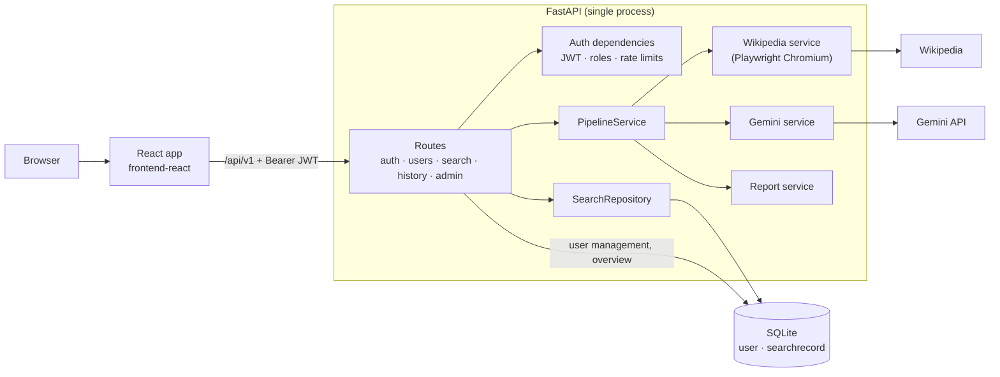

# VerifyLens - Wikipedia Image Verifier (Task 03, PHX-433)

VerifyLens takes a Wikipedia topic, finds the article and its main image, and
asks Google Gemini whether the image actually fits the article. It then
produces a Markdown verification report. Every search is saved in SQLite and
tied to the user who ran it. Users sign in. Admins manage accounts.

**Status (2026-11-23):** all 7 Jira requirements are implemented. 5 are
verified by automated tests. 2 still need a recorded end-to-end run against
the real Wikipedia and Gemini services; see [Testing & Verification](#7-testing--verification).

---

## 1. Project Overview

**Objective (Jira PHX-433, "Database Writing and Login System").** Add login
and role-based access to the FastAPI backend from Task 02. Add a React
frontend. Store users, searches and reports in SQLite.

**In scope:** sign-in, two roles (Admin, User), admin user management,
Wikipedia search with Gemini image verification, Markdown reports, and
per-user search history.
**Out of scope:** self-registration, email or password-recovery flows,
multi-server deployment, and public internet hosting.

| Layer | Technology |
|---|---|
| Frontend | React 19, Vite 7, `react-markdown` (`frontend-react/`) |
| Backend | Python 3.12, FastAPI, Pydantic, Uvicorn (`app/`) |
| Database | SQLite (WAL mode) through SQLModel / SQLAlchemy (`app/db/`) |
| Scraping | Playwright with headless Chromium (`app/services/wikipedia_service.py`) |
| AI verification | Google Gemini via `google-genai` (`app/services/gemini_service.py`) |
| Security | PyJWT (HS256), Argon2 via `pwdlib` (`security/`) |
| Tests | pytest, FastAPI `TestClient` (`tests/`) |
| Packaging | `Dockerfile` and `docker-compose.yml` (written, **not yet built**) |

```text
app/
  api/         Routes: auth, users, search, history, admin overview, health; rate limits
  db/          models.py, repository.py, migrations.py (additive startup upgrades)
  dto/         Request/response models and validation
  services/    wikipedia, gemini, report, pipeline (orchestration), health
security/      Password hashing, password policy, JWT tokens, secret loading
scripts/       bootstrap_admin, reset_password, backup_db, model_compare, perf_test
tests/         Automated tests (temporary databases, no external calls)
frontend-react/  React app (src/api/client.js is the only backend boundary)
```

---

## 2. Functional & Non-Functional Requirements

### Functional requirements

**Original Jira requirements**

| ID | Requirement | Implementation | Status |
|---|---|---|---|
| FR-01 | Authentication and authorization in the FastAPI backend | `/auth/login` issues a JWT. Every route except `/health` and `/auth/login` requires it (`app/api/auth_dependencies.py`). | ✅ Implemented and tested |
| FR-02 | Two user types: Admin and User | `user.role`, restricted to `admin` or `user` by a database CHECK constraint | ✅ Implemented and tested |
| FR-03 | Admin can create and manage users | `/users`: create, list/search, edit name, role and active flag, reset password, delete (`app/api/user_routes.py`) | ✅ Implemented and tested |
| FR-04 | Normal users access only authorized functionality | `require_admin` guards `/users/*` and `/admin/*`. Users see only their own history; another user's record returns 404. | ✅ Implemented and tested |
| FR-05 | Search Wikipedia topics and receive image verification reports | `POST /search` runs scrape → download → Gemini → Markdown report (`app/services/pipeline_service.py`) | ⚠️ Implemented. Tested with fakes and offline stubs. **Real end-to-end run not yet recorded.** |
| FR-06 | React frontend | `frontend-react/`: sign-in, verify, history, admin overview, user management | ⚠️ Implemented. Production build passes. **No recorded browser run against the live backend.** |
| FR-07 | SQLite persistence and search history | `searchrecord` and `user` tables. History is paged and filterable (`app/api/history_routes.py`). | ✅ Implemented and tested |

**Added during development (engineering requirements, not in the Jira issue)**

| ID | Requirement | Status |
|---|---|---|
| FR-08 | Admin-created and admin-reset passwords are temporary. The user must change the password before doing anything else, and the server enforces this. | ✅ Tested |
| FR-09 | Users change their own password. Doing so signs out all their other sessions. | ✅ Tested |
| FR-10 | Owner or admin can delete a history record. Deleting a user keeps their searches, unlinked, for admin review. | ✅ Tested |
| FR-11 | Admin overview: users, searches by outcome, 30-day activity, top users, recent errors | ✅ Tested |
| FR-12 | System status check of API, database, Gemini and Wikipedia (external checks cached for 60 s) | ✅ Tested (external checks mocked) |
| FR-13 | Failed searches are saved as `ERROR` with a reference ID. Temporary Gemini outages return 503 "try again". | ✅ Tested |

### Non-functional requirements

The Jira issue specifies no non-functional requirements. All of the following
are **engineering standards adopted for this project**, not approved
acceptance criteria.

| ID | Category | Requirement | Status |
|---|---|---|---|
| NFR-01 | Security | Passwords stored only as Argon2 hashes. At least 12 characters, and must not contain the username. | ✅ Tested |
| NFR-02 | Security | JWT expires (default 30 min) and is checked for issuer and audience. A password change revokes old tokens. | ✅ Tested |
| NFR-03 | Security | The app refuses to start without a `JWT_SECRET_KEY` of at least 32 characters. Secrets never go in code or the image. | ✅ Tested |
| NFR-04 | Security | Rate limits: login per IP (10/min) and per username (5/min), searches per user (5/min), password changes. All configurable. | ✅ Tested |
| NFR-05 | Security | Authorization enforced on the server. React hides admin screens for convenience only. | ✅ Tested |
| NFR-06 | Reliability | Each Gemini request is cut off after 75 s. Temporary errors (408/429/5xx) are retried with backoff. The total wait is capped at 2× the timeout. | ✅ Tested (mocked) |
| NFR-07 | Reliability | Gemini output is validated against a JSON schema. Truncated, repetitive or over-long answers are rejected. | ✅ Tested (mocked) |
| NFR-08 | Data safety | Schema changes at startup only add tables and columns. Online backup script provided. | ✅ Tested |
| NFR-09 | Performance | Lists use keyset pagination capped at 50 rows. Admin overview uses aggregate queries. | ✅ Paging tested. `scripts/perf_test.py` exists; its results are not recorded here. |
| NFR-10 | Testability | Tests use temporary databases and fake or stubbed Wikipedia and Gemini. They never touch `data/`. | ✅ Verified |

---

## 3. System Architecture



In development, Vite serves React on `:5173` and forwards `/api` to FastAPI on
`:8000`. In single-server mode, FastAPI serves the built app (`frontend-react/dist`)
on the same origin, so CORS is not needed.

**Search workflow (`POST /api/v1/search`)**

1. The JWT is validated and the user loaded. The search rate limit is checked.
2. A `PENDING` search record is saved, owned by that user.
3. Playwright opens Wikipedia, searches the topic, and extracts the title, first paragraph, infobox fields and main image URL. Then it downloads the image to a temporary folder.
4. Gemini receives the article text and the image. It returns `{description, reason, matches}`, which is validated against a schema.
5. The Markdown report is generated. The record is updated to `SUCCESS` with the report, infobox fields (JSON) and verdict.
6. The response returns the report. React renders it and offers a `.md` download.
   On failure, the record is marked `ERROR` (stores the exception type only) and the client gets 503 or 500 with the record ID.

---

## 4. Engineering Decisions

"Rationale" is either visible in the code or comments, or stated as a
requirement. Where the original motivation was not recorded, the table says so.

| Decision | Rationale | Trade-off / limitation |
|---|---|---|
| **React + FastAPI** | Both named in the Jira issue. FastAPI carries over the Task 02 backend and provides OpenAPI docs at `/docs`. | Two toolchains (Python, Node) to install. |
| **SQLite** | Named in the Jira issue. A single file, no server to run. | One writer at a time, so the app must run as **one process** (see Limitations). |
| **SQLModel** | One class is both the table and the Pydantic model. *Why it was chosen over plain SQLAlchemy was not recorded.* | No Alembic. `app/db/migrations.py` can only add tables and columns. |
| **Repository pattern** | `SearchRepository` keeps search-record SQL out of the route handlers. *Original motivation not recorded.* | Applied to search records only. User and admin routes query SQLModel directly. |
| **JWT (HS256) + Argon2** | Stateless tokens with a 30-min expiry. A `token_version` claim lets a password change revoke old tokens. Argon2 is the `pwdlib` default and a memory-hard hash. | Token is kept in React memory only (not `localStorage`), so refreshing the page signs you out. |
| **RBAC + user-owned records** | The Jira issue requires that normal users reach only what they are authorized for. Each search stores `user_id` taken from the token, never from the request. Non-owners get 404, so record IDs are not revealed. | Old records with no owner are visible only to admins. |
| **Playwright** | Drives Wikipedia's own search box and reads the rendered page, so a search term resolves the way it does for a person. *Why Playwright rather than the Wikipedia API was not recorded.* | Needs a Chromium download. Slower than an API call. Breaks if Wikipedia changes its page structure. |
| **Gemini `gemini-3.5-flash-lite`, thinking level `low`** | A code comment in `app/settings.py` says the previous model, `gemini-2.5-flash`, shuts down on 2026-12-01 and that this is its named replacement at the same price; the date and price have not been checked against Google's documentation. `scripts/model_compare.py` compared Flash-Lite at the `minimal`, `low` and `medium` thinking levels on 40 hand-labelled cases (2026-11-22). The final `low` run scored 40/40. | Only Flash-Lite variants were compared. The labels are the author's assumption, not human-reviewed. An earlier run had one near-miss error (Marie Curie article with Pierre Curie image judged a match). Override with `GEMINI_MODEL`. |
| **Infobox data as JSON (`fields_json`)** | Infobox fields differ between articles (a person vs. a bridge), so they are stored as a key/value JSON text column. | Not queryable as columns. Fine, since it is only displayed. |
| **Dependency injection + fakes in tests** | `PipelineService` takes its scraper, downloader, verifier and reporter as parameters. Routes get it via `Depends(get_pipeline_service)`, which tests override. | Fakes prove the API logic, not that the real Wikipedia and Gemini still behave the same. That needs a separate live check. |
| **In-memory rate limits** | No extra infrastructure. It matches the single-process deployment. | Counters reset on restart and do not work across several processes. |

---

## 5. Database & Security

| Table | Key columns |
|---|---|
| `user` | `username` (unique), `hashed_password`, `role` (`admin` or `user`, CHECK constraint), `is_active`, `full_name`, `token_version`, `must_change_password`, `created_at` |
| `searchrecord` | `query`, `status` (`PENDING`, `SUCCESS` or `ERROR`), `matches`, `article_title`, `source_url`, `image_url`, `fields_json`, `report_markdown`, `error_message`, `created_at` (UTC), `user_id` → `user.id` |

Tables are created, and missing columns added, automatically at startup.
Default location: `data/search_history.db` (override with `DATABASE_PATH`).

**Authentication.** `POST /api/v1/auth/login` (OAuth2 password form) returns a
JWT. Inactive users cannot sign in. Every request reloads the user, so a
deactivated or deleted account loses access immediately.

**Authorization.**

| Capability | User | Admin |
|---|:-:|:-:|
| Search topics, view and download reports | ✅ | ✅ |
| View and delete own history | ✅ | ✅ |
| View and delete **all** history (including unowned records) | — | ✅ |
| Change own password | ✅ | ✅ |
| Create, edit, deactivate, delete users; reset passwords | — | ✅ |
| Admin overview | — | ✅ |
| System status | ✅ | ✅ |

Safeguards: an admin cannot demote, deactivate, delete or reset-password
themselves through user management, and at least one active admin must
always remain.

**Credential protection.**
- Secrets are read from environment variables, `.env` (local development
  only), or files in `SECRETS_DIR` (default `/run/secrets`).
- `.env`, `data/` and `*.db` are listed in `.gitignore` and `.dockerignore`.
- API responses never include password hashes. Errors store only the
  exception class name.
- Reports render without raw HTML, so report text cannot inject markup or
  scripts.

---

## 6. Installation & Execution

Prerequisites: Conda or Mamba (Miniforge), and internet access for Wikipedia
and Gemini. Run all commands from the project root unless stated otherwise.

```bash
# 1. Environment (Python 3.12 + Node.js for the frontend)
conda create -n task03 python=3.12 nodejs
conda activate task03

# 2. Dependencies
pip install -r requirements.txt          # requirements-prod.txt = pinned runtime set used by the Dockerfile
playwright install chromium

# 3. Configuration
cp .env.example .env && chmod 600 .env   # then set JWT_SECRET_KEY and GEMINI_API_KEY
python -c "import secrets; print(secrets.token_urlsafe(48))"   # generates a JWT_SECRET_KEY

# 4. First admin (creates the database if needed; prompts for the password)
python -m scripts.bootstrap_admin --username admin

# 5. Run (two terminals)
uvicorn app.main:app --reload                       # API on http://127.0.0.1:8000
cd frontend-react && npm install && npm run dev     # UI on http://127.0.0.1:5173
```

**Single-server mode:** run `cd frontend-react && npm run build`, then
`uvicorn app.main:app`. This serves both the UI and the API on `:8000`.
Run uvicorn from the project root, because `.env` is read from the current
folder.

**API documentation:** http://127.0.0.1:8000/docs (Swagger UI) or `/openapi.json`.

| Variable | Default | Purpose |
|---|---|---|
| `JWT_SECRET_KEY` | — (**required**, ≥ 32 chars) | Signs login tokens. Changing it signs everyone out. |
| `GEMINI_API_KEY` | — | Without it the app starts, but searches fail. |
| `GEMINI_MODEL` | `gemini-3.5-flash-lite` | Gemini model |
| `GEMINI_THINKING_LEVEL` | `low` | `minimal`, `low`, `medium` or `high` (Gemini 3+) |
| `GEMINI_TIMEOUT_SECONDS` | `75` | Per-request timeout (10–300) |
| `HEADLESS` | `true` | Run Chromium headless |
| `DATABASE_PATH` | `data/search_history.db` | SQLite file |
| `JWT_ACCESS_TOKEN_MINUTES` | `30` | Token lifetime |
| `LOGIN_ATTEMPTS_PER_IP_PER_MINUTE` / `_PER_USERNAME_` / `SEARCHES_PER_USER_PER_MINUTE` | `10` / `5` / `5` | Rate limits |
| `VITE_API_BASE_URL` (`frontend-react/.env`) | `/api/v1` | API base path for React |
| `VITE_DEMO_MODE` (`frontend-react/.env`) | `false` | UI preview with fake data. **Never enable for real use.** |

**Operations:**

| Task | Command |
|---|---|
| Admin forgot password | `python -m scripts.reset_password --username admin` (password is prompted) |
| Back up the database (safe while the app runs) | `python -m scripts.backup_db` |
| Run tests | `python -m pytest tests` |

Docker deployment to an internal server is described in [DEPLOY.md](DEPLOY.md).
It has **not been tested yet**.

---

## 7. Testing & Verification

**Automated results (run 2026-11-23, Linux, Python 3.12.16, pytest 9.2.0):
218 passed, 0 failed, 54.3 s.**

| Area | Test files |
|---|---|
| Login, tokens, rate limits, secrets | `test_auth_api`, `test_password_reset`, `test_rate_limit`, `test_secrets`, `test_user_foundation` |
| Roles and ownership | `test_rbac_api`, `test_delete_api`, `test_history_paging`, `test_user_paging` |
| Search API (fake pipeline) and Gemini errors | `test_search_api`, `test_search_gemini_errors`, `test_api` (old `/report` route stays removed) |
| Gemini service (mocked client) | `test_gemini_service` |
| Scraper (offline Chromium with stubbed pages) and report generator | `test_wikipedia_service`, `test_report_service` |
| Admin overview, system status, backups, frontend serving | `test_admin_overview`, `test_system_status`, `test_backup_db`, `test_frontend_serving` |

**Strategy.** Each test uses a temporary SQLite database. `tests/conftest.py`
redirects the app away from `data/` before any import. Requests go through the
real login, so role and ownership rules are tested end to end inside the API.
Wikipedia and Gemini are always replaced by fakes, mocks or offline stubs.

**Frontend.** `npm run build` (Vite 7.3.8) succeeded on 2026-11-23.
`npm test` (Vitest): 33 passed, covering the password-recovery screens and
admin email fields only. The rest of the UI has no automated tests.

**Live Gemini evidence.** `scripts/model_compare.py` (2026-11-22) called the
real Wikipedia and Gemini for 40 labelled cases. The final run scored 40/40.
This shows the verifier works against the live API, but it is not an
end-to-end test of the web app.

**Not yet verified:**
- Manual end-to-end run in the browser: an admin creates a user; that user
  changes the temporary password, searches, opens the report and history, and
  is blocked from admin screens and others' records.
- Installing from `requirements.txt` into a fresh environment.
- Docker image build and container start.
- `npm audit` and dependency vulnerability scan.

---

## 8. Known Limitations

- **Single process only.** SQLite allows one writer, and rate-limit counters
  live in memory. Do not run several workers or containers.
- **Scraper depends on Wikipedia's page structure.** It uses the first infobox
  image, or the first article figure. A layout change or an unusual article
  can make searches fail with `ERROR`.
- **The Gemini verdict is an AI judgement, not ground truth.** Closely related
  images, such as a spouse's portrait, can be accepted as a match.
- **The report links the image by its Wikipedia URL.** The downloaded copy is
  temporary and not stored.
- **Refreshing the page signs the user out.** The token is held in memory only.
- **No logging configuration.** The app adds no logging setup of its own, so
  INFO-level messages (such as the admin password-reset audit line) may not
  appear under default Uvicorn settings. Not verified.
- **Schema changes are additive only.** Renaming or dropping columns needs a
  manual script and a backup first.
- `requirements.txt` is mostly unpinned (only `google-genai` is pinned).
  Use `requirements-prod.txt` for a reproducible install.
- Demo-mode UI text is still included in the production bundle. It is inactive
  when `VITE_DEMO_MODE=false`.
